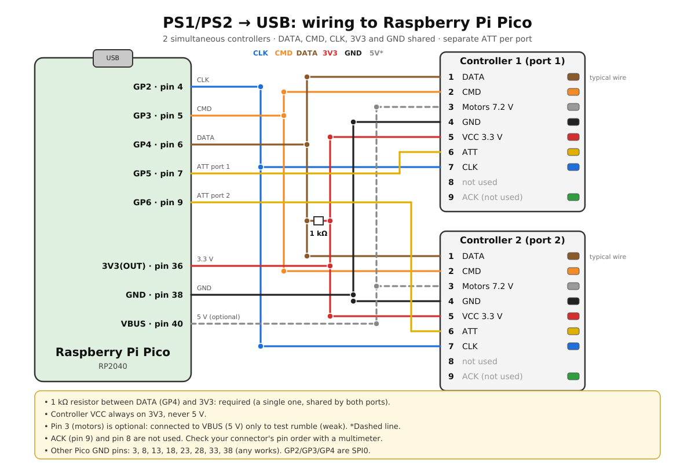
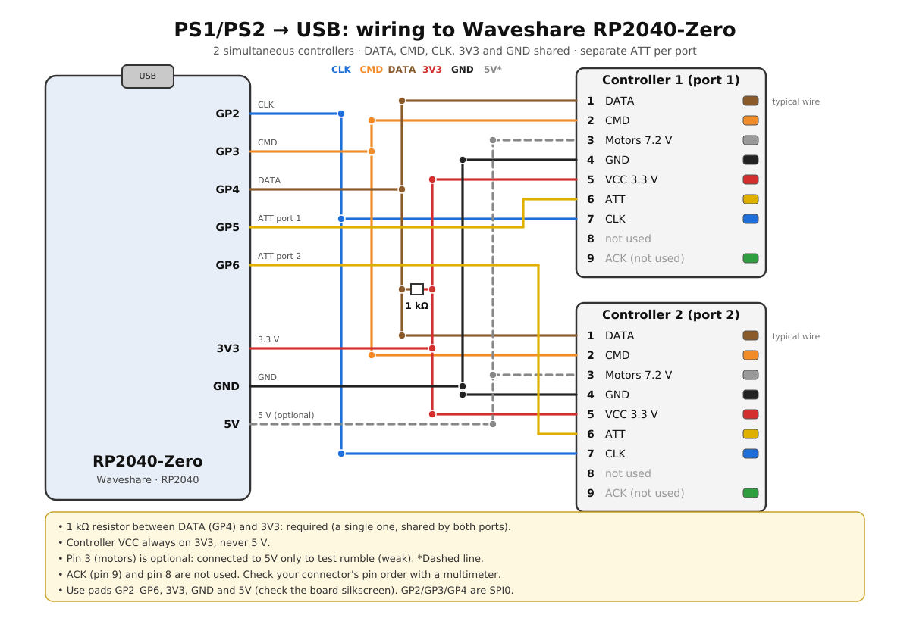

# PS1/PS2 -> USB (RP2040-Zero), 2 controllers

[Português](README.md) | **English**

USB adapter for **2 simultaneous PS1/PS2 controllers** using an RP2040 (RP2040-Zero or Pico).
Each port shows up on the PC as a separate HID gamepad (recognized in `joy.cpl`, in games and in
the browser). Use it for playing, or as a test/repair bench for controllers.

- Supports digital PS1 pads, DualShock 1 and 2 (analog) and the PS1 analog joystick.
- DualShock pads are switched to analog mode automatically; on the DualShock 2 the L2/R2 pressure is read.
- Rumble test: **SELECT + START + L1** (small motor) and **SELECT + START + R1** (large motor).
- License: MIT.

> Status: firmware written and syntax-checked, but **not yet tested on hardware**.

## Wiring

Both ports share DATA, CMD, CLK, 3V3 and GND. Only ATT is separate (like on the console).

| Connector (pin) | Function | RP2040-Zero |
|---|---|---|
| 1 (DATA, brown) | controller output | GP4 + **1 kΩ resistor to 3V3** (required) |
| 2 (CMD, orange) | controller input | GP3 |
| 3 (motors, gray) | 7.2 V rumble supply | 5V/VBUS (test only, weak) or unconnected |
| 4 (GND, black) | GND | GND |
| 5 (VCC, red) | power | **3V3** (never 5 V) |
| 6 (ATT, yellow) | select | GP5 (port 1) / GP6 (port 2) |
| 7 (CLK, blue) | clock | GP2 |
| 8 | not used | – |
| 9 (ACK, green) | acknowledge | not used |

Check your connector's pin order with a multimeter before powering it.
Pins are defined in `psx.h` (SCK/CMD/DAT must be SPI0 pins: GP2/GP3/GP4 or GP18/GP19/GP16).

### Wiring diagrams

Raspberry Pi Pico:

RP2040-Zero (optional):

Vector versions (SVG) are in `docs/`.

## Flashing

Hold the BOOT button on the RP2040-Zero, plug in the USB cable and release it. The board shows up as a
drive (RPI-RP2). Copy the `.uf2` onto it; the board reboots by itself.

## Mapping

Buttons follow the browser *Standard Gamepad* order.

| HID | PlayStation | HID | PlayStation |
|---|---|---|---|
| B1 | ✕ | B7 | L2 |
| B2 | ○ | B8 | R2 |
| B3 | □ | B9 | Select |
| B4 | △ | B10 | Start |
| B5 | L1 | B11 | L3 |
| B6 | R1 | B12 | R3 |

D-pad: hat (POV). Left stick: X/Y. Right stick: Z/Rz. Slider/Dial: L2/R2 pressure
(DualShock 2; on other pads it is 0 or 255).

## Browser test (hardwaretester.com/gamepad)

The adapter is a generic HID gamepad: the browser shows buttons and axes by index, but may not draw
the standard console layout (that depends on the browser knowing the VID/PID).
Press a button on the controller first, because browsers only list a gamepad after the first input.

## Status LED (RP2040-Zero)

The on-board RGB LED (GP16) shows the connection to the computer:

| Color | Meaning |
|---|---|
| Solid green | Connected to the computer (USB enumerated), no controller detected |
| Solid blue | Connected to the computer and at least 1 PS1/PS2 controller detected |
| Solid yellow | USB suspended (computer asleep) |
| Blinking red | Board powered, but the computer has not enumerated the USB device yet |

Options in `led.h`: `STATUS_LED_LEVEL` (brightness 0–255), `STATUS_LED_SHOW_PADS` (0 = always green),
`STATUS_LED_MODE` (0 = no LED, 1 = RP2040-Zero WS2812, 2 = plain LED, e.g. Pico on GP25).

## Tuning

- `PSX_BYTE_GAP_US` (psx.h): delay between bytes. If the pad stays digital-only or is unstable, raise it to 30–40.
- `PSX_BAUD` (psx.h): bus clock. With long wires or noise, lower it to 125000.
- `USB_VID` / `USB_PID` (usb_descriptors.c): TinyUSB test values. Change them if you distribute the adapter.

## Troubleshooting

| Symptom | Likely cause |
|---|---|
| Nothing shows up in `joy.cpl` | Missing 1 kΩ pull-up on DATA, VCC not at 3.3 V, CMD/DATA swapped |
| Buttons only, no analog | Pad in digital mode (ID 0x41); raise `PSX_BYTE_GAP_US` |
| Random inputs | Long wires or no common GND; lower `PSX_BAUD` |
| Weak rumble | Pin 3 at 5 V; the original motor uses ~7.2 V |

## Protocol

SPI mode 3 (clock idles high), LSB first, ~250 kHz. Poll: `01 42 00 [motor1] [motor2] ...`;
reply: `FF, ID, 5A, data`. IDs: `41` digital, `73` analog, `79` analog with pressure, `F3` config mode.
Buttons are active-low (0 = pressed).
