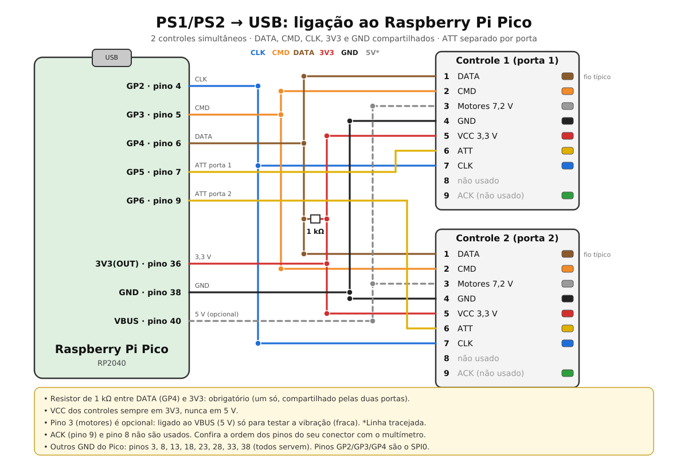
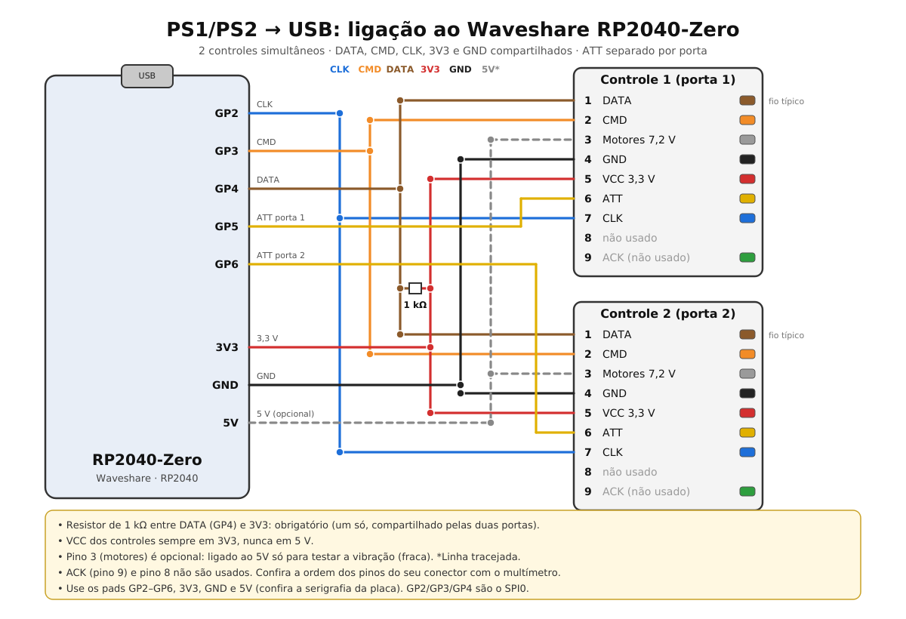

# PS1/PS2 -> USB (RP2040-Zero), 2 controles

**Português** | [English](README.en.md)

Adaptador USB para **2 controles PS1/PS2 simultâneos** com RP2040 (RP2040-Zero ou Pico).
Cada porta aparece no PC como um gamepad HID separado (reconhecido no `joy.cpl`, nos jogos e
no navegador). Serve para jogar e como bancada de teste/reparo de controles.

- Suporta PS1 digital, DualShock 1 e 2 (analógico) e joystick analógico PS1.
- O DualShock é colocado sozinho em modo analógico; no DualShock 2 a pressão de L2/R2 é lida.
- Teste de vibração: **SELECT + START + L1** (motor pequeno) e **SELECT + START + R1** (motor grande).
- Licença: MIT.

> Status: firmware escrito e com sintaxe verificada, mas **ainda não testado em hardware**.

## Ligação

As duas portas compartilham DATA, CMD, CLK, 3V3 e GND. Só o ATT é separado (como no console).

| Conector (pino) | Função | RP2040-Zero |
|---|---|---|
| 1 (DATA, marrom) | saída do controle | GP4 + **resistor de 1 kΩ para 3V3** (obrigatório) |
| 2 (CMD, laranja) | entrada do controle | GP3 |
| 3 (motores, cinza) | 7,2 V da vibração | 5V/VBUS (só teste, fraca) ou livre |
| 4 (GND, preto) | GND | GND |
| 5 (VCC, vermelho) | alimentação | **3V3** (nunca 5 V) |
| 6 (ATT, amarelo) | seleção | GP5 (porta 1) / GP6 (porta 2) |
| 7 (CLK, azul) | clock | GP2 |
| 8 | não usado | – |
| 9 (ACK, verde) | confirmação | não usado |

Confira a ordem dos pinos do seu conector com o multímetro antes de ligar.
Os pinos ficam em `psx.h` (SCK/CMD/DAT precisam ser SPI0: GP2/GP3/GP4 ou GP18/GP19/GP16).

### Esquema de ligação

Raspberry Pi Pico:



RP2040-Zero (opcional):



As versões vetoriais (SVG) estão em `docs/`.

## Gerar o .uf2

### Opção A: GitHub Actions (sem instalar nada)

1. Crie um repositório e envie estes arquivos (inclusive `.github/`).
2. Abra a aba Actions, execute "build-uf2" (ou apenas faça um push).
3. Baixe o artefato `ps2_usb_rp2040-uf2`; dentro está o `ps2_usb_rp2040.uf2`.

### Opção B: local (Linux/WSL)

```
sudo apt install cmake build-essential gcc-arm-none-eabi libnewlib-arm-none-eabi libstdc++-arm-none-eabi-newlib
git clone --recurse-submodules https://github.com/raspberrypi/pico-sdk.git ~/pico-sdk
export PICO_SDK_PATH=~/pico-sdk
cmake -B build -S .
cmake --build build -j
```

O arquivo sai em `build/ps2_usb_rp2040.uf2`.

## Gravar

Segure o botão BOOT da RP2040-Zero, conecte o USB e solte. Ela aparece como um disco (RPI-RP2).
Copie o `.uf2` para ele; a placa reinicia sozinha.

## Mapeamento

Os botões seguem a ordem do *Standard Gamepad* dos navegadores.

| HID | PlayStation | HID | PlayStation |
|---|---|---|---|
| B1 | ✕ | B7 | L2 |
| B2 | ○ | B8 | R2 |
| B3 | □ | B9 | Select |
| B4 | △ | B10 | Start |
| B5 | L1 | B11 | L3 |
| B6 | R1 | B12 | R3 |

D-pad: hat (POV). Analógico esquerdo: X/Y. Direito: Z/Rz. Slider/Dial: pressão de L2/R2
(DualShock 2; nos demais vale 0 ou 255).

## Teste no navegador (hardwaretester.com/gamepad)

O adaptador é um gamepad HID genérico: o navegador mostra botões e eixos por índice, mas pode não
desenhar o layout "padrão" de console (isso depende do VID/PID ser conhecido pelo navegador).
Aperte um botão no controle antes, pois o navegador só lista o gamepad depois do primeiro input.

## LED de status (RP2040-Zero)

O LED RGB da placa (GP16) mostra a conexão com o computador:

| Cor | Significado |
|---|---|
| Verde fixo | Conectado ao computador (USB reconhecida), nenhum controle detectado |
| Azul fixo | Conectado ao computador e pelo menos 1 controle PS1/PS2 detectado |
| Amarelo fixo | USB suspensa (computador dormindo) |
| Vermelho piscando | Placa ligada, mas o computador ainda não reconheceu a USB |

Ajustes em `led.h`: `STATUS_LED_LEVEL` (brilho 0–255), `STATUS_LED_SHOW_PADS` (0 = sempre verde),
`STATUS_LED_MODE` (0 = sem LED, 1 = WS2812 da Zero, 2 = LED comum, ex.: Pico em GP25).

## Ajustes

- `PSX_BYTE_GAP_US` (psx.h): pausa entre bytes. Se o controle ficar só digital ou instável, aumente para 30–40.
- `PSX_BAUD` (psx.h): clock do barramento. Com fios longos ou ruído, reduza para 125000.
- `USB_VID` / `USB_PID` (usb_descriptors.c): valores de teste do TinyUSB. Troque se for distribuir.

## Solução de problemas

| Sintoma | Causa provável |
|---|---|
| Nada aparece no `joy.cpl` | Pull-up de 1 kΩ no DATA ausente, VCC fora de 3,3 V, CMD/DATA trocados |
| Só botões, sem analógico | Controle em modo digital (ID 0x41); aumente `PSX_BYTE_GAP_US` |
| Entradas aleatórias | Fios longos ou sem GND em comum; reduza `PSX_BAUD` |
| Vibração fraca | Pino 3 em 5 V; o motor original usa ~7,2 V |

## Protocolo

SPI modo 3 (clock em repouso alto), LSB primeiro, ~250 kHz. Poll: `01 42 00 [motor1] [motor2] ...`;
resposta: `FF, ID, 5A, dados`. IDs: `41` digital, `73` analógico, `79` analógico com pressão, `F3` configuração.
Botões em lógica invertida (0 = pressionado).
